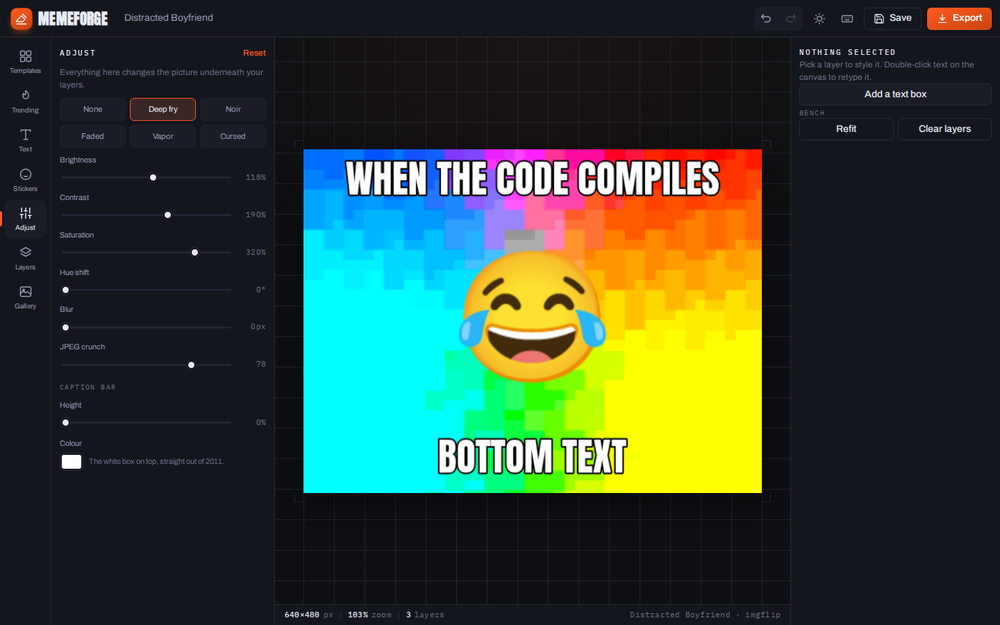

# MemeForge

A meme studio that runs entirely in your browser. Pick a template or drop your
own picture, stack text and stickers on it, and export a PNG or an animated GIF.
No account, no upload, no watermark — every pixel is processed on your machine.



## What it does

**Pictures**
- ~900 templates merged from [Imgflip](https://imgflip.com) and
  [Memegen](https://memegen.link), searched fuzzily (Fuse.js) so "distrated
  boyfrend" still finds it.
- A trending feed pulled live from Reddit meme subs — grab today's format
  before it goes stale.
- Drop a file, paste with `Ctrl+V`, paste an image URL, or add a second picture
  as a layer to composite two memes.
- Recent uploads come back under **Yours**.

**Type**
- Every Google font — around 1,900 families, fetched on demand and previewed in
  their own face as you scroll the list.
- Or upload a `.ttf`/`.otf`/`.woff2` of your own; it is remembered next visit.
- Six text presets (Impact, Clean, Neon, Tag, Typewriter, Quote), plus fill,
  outline, glow, caps, alignment, spacing, line height, rotation and opacity.
- Impact renders as Impact on Windows and macOS and falls back to a bundled
  Anton everywhere else, so the classic look survives Linux.

**The picture underneath**
- Brightness, contrast, saturation, hue, blur and JPEG crunch.
- Presets: Deep fry, Noir, Faded, Vapor, Cursed.
- The classic white caption bar above the image, at any height.

**Animated GIFs**
- Import a GIF, keep it playing while you position layers on top, then export a
  new animated GIF with everything burned in.

**The workshop**
- Layers panel with drag-to-restack, hide and delete.
- Undo/redo across layers *and* filters, keyboard shortcuts throughout.
- Autosave: close the tab mid-meme and it is still on the bench when you return.
- A gallery of saved memes in IndexedDB, on your device only.
- Export PNG / JPG / WebP at 1×, 2× or 4×, copy straight to the clipboard, or
  hand off to the system share sheet.
- Installable as a PWA and usable offline apart from the remote libraries.

## Running it

It is a static site with no build step. Any file server will do:

```sh
npm run dev          # http-server on :8099
# or
python3 -m http.server 8099
```

Then open <http://127.0.0.1:8099/>. Deploying means copying the folder to any
static host.

## Publishing to GitHub Pages

`.github/workflows/static.yml` publishes the repository as-is on every push to
`main`. Set **Settings → Pages → Build and deployment → Source: GitHub Actions**
once, and the site lands at `https://<owner>.github.io/<repo>/`.

Keep it to one Pages workflow. Deploy workflows share the `pages` concurrency
group, so two of them on the same trigger just queue up and the last one to
finish decides what is published.

There is no build step and nothing here needs Jekyll, so the workflow uploads
the tree untouched. `.nojekyll` is kept for the other Pages mode — if the source
is ever switched to *Deploy from a branch*, that build runs the repository
through Jekyll, and the file turns it off.

Every path in the app is relative, so a project site served from a subdirectory
works without configuration — `npm run test:subpath` proves it (serve the parent
directory on port 8100 first).

## Tests

Two Playwright suites drive the real app in Chromium:

- `tests/smoke.mjs` stubs the meme APIs and covers the whole path — grid,
  canvas, fonts, filters, layers, undo, PNG export, GIF decode and re-encode,
  gallery, mobile layout — without depending on anyone else's uptime.
- `tests/offline.mjs` kills every off-origin request and checks the app still
  loads, says what is unreachable, and stays usable on bundled fonts.

```sh
npm install          # playwright
npm run dev &        # serve on :8099
npm test
```

Screenshots land in `tests/shots/`.

## How it is put together

```
index.html          shell and panel markup
css/app.css         design system: graphite panels, ember accent, mono readouts
js/main.js          boot, top bar, export, shortcuts, autosave
js/studio.js        the canvas: media layer, layers, filters, history, export
js/panels.js        left drawer: templates, trending, text, stickers, adjust, layers, gallery
js/inspector.js     right column: controls for whatever is selected
js/sources.js       template and trending feeds, merged and cached
js/fonts.js         font catalogue and on-demand loading
js/media.js         GIF decode/encode, video extraction and clip composition
js/workbench.js     projects, canvas tools, frame/time controls and context menus
js/advanced.js      layer timing tracks, batch edits, motion, drawing and GIF output
js/store.js         IndexedDB and settings
sw.js               offline shell
```

The picture on the bench is drawn into an offscreen canvas, with the adjustment
filters applied, and used as the Fabric canvas background. Still images and GIF
frames go through the same path, which is why filters, layers and export behave
identically for both.

Every remote call is wrapped: if Imgflip, Memegen, Reddit or the font catalogue
is unreachable, the app says so in the panel and keeps working with what it has.
Images from hosts that send no CORS headers are retried through public image
proxies so exports stay possible.

## Third-party code

Vendored in `vendor/` so the app has no CDN dependency and works offline:

| Library | Version | Licence | Used for |
| --- | --- | --- | --- |
| [Fabric.js](https://fabricjs.com) | 6.9.1 | MIT | canvas object model, transforms, text editing |
| [gifuct-js](https://github.com/matt-way/gifuct-js) | 2.1.2 | MIT | GIF decoding |
| [gif.js](https://github.com/jnordberg/gif.js) | 0.2.0 | MIT | GIF encoding |
| [Fuse.js](https://fusejs.io) | 7.5.0 | Apache-2.0 | fuzzy template search |
| [idb-keyval](https://github.com/jakearchibald/idb-keyval) | 6.3.0 | Apache-2.0 | IndexedDB storage |
| [SortableJS](https://sortablejs.github.io/Sortable/) | 1.15.7 | MIT | drag to restack layers |
| Archivo, Anton, IBM Plex Mono | Fontsource 5.3 | OFL-1.1 | the interface itself |

MemeForge is MIT licensed — see [LICENSE](LICENSE).

## Workbench editing

- Use **Project** to start clean, rename (including on mobile), download an editable
  `.memeforge` backup, reopen a backup, or save the current result as a personal template.
  Backups embed the background, image layers, GIF timing, frame edits and uploaded fonts.
  Gallery and autosave stay local; the toolbar reports storage failures.
- Paste a direct image/GIF URL into the library's **Import** field. Links without a
  filename extension are detected by their contents. Hosts must permit CORS or work
  through one of the fallback proxies; a web page URL is not an image URL.
- Star templates to find them under **Favorites**, revisit **Recent**, or load further
  pages of results. Personal templates appear under **Yours**.
- **Crop** offers precise coordinates; **Draw crop** selects a background region by
  dragging. Cropping is reversible and applies to every GIF frame. **Adjust → Spacing
  & Padding** sets background space independently on all four sides in pixels, with a background color.
- Use **Fit**, the zoom buttons or Ctrl+wheel. **Pan** moves the view without changing
  output. On touch devices use two fingers to zoom. **Snap** shows center guides;
  layer controls also offer horizontal/vertical centering and text fitting.
- Right-click a canvas layer for duplicate, delete, stacking, centering, visibility,
  locking and text fitting. Right-click empty canvas to add text/shapes or crop.
  Touch supports long press, and Shift+F10 opens the menu on a focused canvas.
- **Collage** creates two horizontal/vertical panels or a four-panel grid with panel
  spacing and outer padding. Pictures are editable layers; right-click a panel to
  replace its picture. GIF inputs in a collage are used as still pictures.

## GIF: Frame and Video modes

Both modes edit and export an animated GIF, without converting it to a video.

**Frame** pauses on a frame. New layers and edits apply to the selected frames
(one frame by default); text, position, styling and filters can differ per frame. A frame's
context menu duplicates/deletes it or downloads a still PNG. Drag thumbnails to
reorder frames; undo/redo includes these operations.

**Video** provides playback and a time scrubber. New layers span the clip by
default; layer controls set visibility using frame numbers or seconds. The
controls support range trimming, per-frame/range delays, reversal and an explicit
FPS change. Imported variable delays remain unchanged unless you edit them.
Setting 120 frames to 24 FPS gives a 5-second clip. GIF's centisecond timing is
rounded cumulatively on export to preserve total duration.

There is no silent 120/160-frame cut. Inputs over 1,200 frames or roughly 192 MB
of decoded pixels are rejected with an explanation; oversized exports ask for a
lower scale or trim. These limits protect browser memory. Images still normalize
to a 1,600 px edge and GIFs to 720 px, as in the original editor.

Run `npm run test:editor` with a server on port 8099 to verify the new tools,
portable reopening, 24 FPS timing, frame-specific rendering, long GIF exports,
collages, mobile layout and cold offline reload. This suite also runs in `npm test`.


### Timeline and creative tools

- Each GIF layer has a time-proportional strip. Drag a strip to move it, or drag
  its ends to change its frame range. Arrow keys move a focused strip; focused
  start/end handles resize it, and Shift+Arrow changes the end.
- Shift-click frame thumbnails to select an interval; Ctrl/Cmd-click toggles
  individual frames. Frame mode text, transforms, drawing and filters apply to
  the selected frames. Batch delay/delete and copy-current-edits actions are
  available below the timeline. Video mode edits remain global.
- Onion skin overlays neighboring **background** frames while paused. Its opacity
  is adjustable; it is never included in downloaded images or GIFs.
- Smart captions recognize Drake, Two Buttons, Distracted Boyfriend and Expanding
  Brain. You can also choose inside/outside layouts explicitly. Personal templates
  now save editable projects, including layers, timing and uploaded fonts; older
  flattened templates remain usable.
- Layer motion includes fade, slide, shake and zoom with duration and strength.
  Motion starts at the layer's timing range and is rendered into the exported GIF.
- Pen/highlighter strokes and speech bubbles are editable layers. Regional blur
  and pixelation use movable boxes over the **background** and follow their layer
  frame ranges. Finish drawing returns to the selection tool.
- GIF output opens an encoded preview with its actual size before download. Set
  width, 32/64/128/256 colors, quality, dithering, frame skipping, identical-frame
  merging and loop count. Skipping/merging preserve elapsed time. Optional target
  size makes up to five attempts with reduced width/colors; the UI reports when a
  target cannot be reached. Source frames remain in the project.
- Import a supported MP4/WebM video, select in/out points, FPS (1–60) and width
  (32–720), then edit the result as a GIF. Audio is omitted. Codec support depends
  on the browser. Limits are checked before frame extraction; import can be
  cancelled. Converted backgrounds are embedded GIFs in portable project files.
- Combine 2–6 GIF files in selection order, sequentially or side by side. Parallel
  clips share a timeline, and shorter clips hold their last frame. The combined
  output becomes an editable GIF background; current overlays remain editable.
  Combined source memory and output frame counts are guarded.

`npm run test:advanced` exercises real GIF decoding, encoded color/timing results,
video conversion, batch edits, tracks, drawing, motion, templates and mobile UI.
